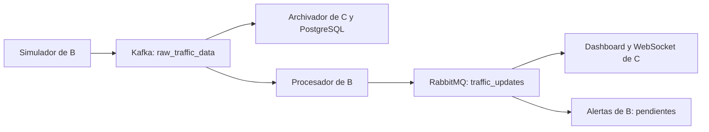
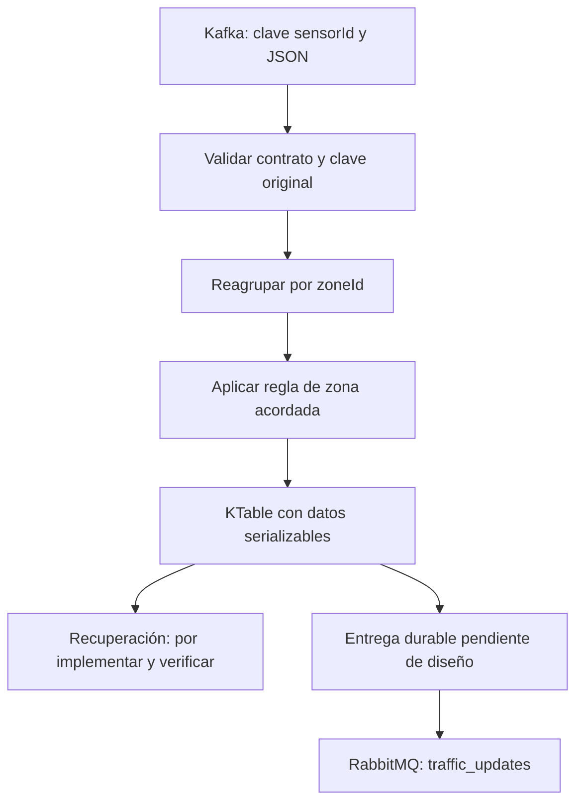

# SmartTraffic: guía para continuar el módulo de la Integrante B

**Última entrega: validación local conjunta R4.4.** Se ejecutó el flujo de JSON,
KTable y publisher real con red AMQP simulada. Los cinco casos nuevos verifican
el caso exitoso y demuestran dos límites: NACK no deshace la tabla local y un
replay puede volver a publicar. El puente existe solo en el test, no en producción.
La guía [local-validation-r4.md](domain-messaging/local-validation-r4.md) explica
los resultados; [commits-pendientes.md](commits-pendientes.md) contiene los 13
commits de código pendientes con sus archivos y comandos exactos, sin docs.

Esta guía explica qué tenemos, cómo probarlo y cómo seguir con Kafka Streams y
KTable.

**Actualización ** la topología KTable ya tiene además un adaptador RabbitMQ
aislado y probado para publicar estados con confirmaciones y detección de returns.
Todavía no están conectados entre sí. Esta guía se actualiza junto al código.
No reemplaza el README general ni modifica módulos de los compañeros.

## 1. Para qué sirve tu módulo

B desarrolla el dominio Java, los servicios y sus adaptadores de mensajería.
A proporciona infraestructura, autenticación y seguridad. C desarrolla persistencia
y visualización. El recorrido previsto es:



El diagrama representa el objetivo. El recorrido completo todavía no se ha
verificado entre las máquinas virtuales.

## 2. Qué está hecho y qué falta

| Componente | Estado real |
|---|---|
| Dominio con agregado, Strategy y State | Implementado y probado; fórmula productiva pendiente |
| Caso de uso y puertos | Implementados y probados en aislamiento |
| Simulador local | Generación periódica implementada y verificada anteriormente |
| Productor Kafka del simulador | Cliente seguro implementado; conexión real pendiente |
| Entrada JSON del procesador | Validación de datos y clave sensorId implementada |
| Instantánea y reconstrucción | Implementadas, conservan observación, resultado y umbrales |
| Serde Kafka de instantáneas | Implementado; convierte datos a bytes y los recupera validando formato |
| KTable del modo actual | Implementada y probada con driver y RocksDB local; arranque contra clúster y recuperación real pendientes |
| Productor RabbitMQ del procesador | Adaptador implementado y probado con mocks; conexión segura y entrega desde KTable pendientes |
| Alertas y consultas | Pendientes de criterios y contratos detallados |

El agregado actual conserva **la última observación aceptada por zona**. No suma
sensores ni procesa ventanas temporales. Detecta duplicados/conflictos del último
UUID aceptado; no mantiene un historial completo de identificadores.

## 3. Cómo comprobar lo que ya funciona

Abre PowerShell en la raíz del repositorio con Java 17 y Maven disponibles:

```powershell
mvn -B -ntp -f density-processor/pom.xml verify
```

El último verify ejecutado aprobó **259 pruebas del procesador y 60 del simulador**,
cero fallos, errores u omisiones, ambos BUILD SUCCESS. Tiempos: 29.288 s y 25.106 s.
Son 319 ejecuciones, sin brokers reales. La validación conjunta nueva usa RocksDB
local, componentes reales de B y un RabbitTemplate simulado.

Para ejecutar solo sus cinco casos:

```powershell
mvn -B -ntp -f density-processor/pom.xml "-Dtest=TrafficPipelineLocalTest" test
```

Para probar únicamente esta entrega:

```powershell
mvn -B -ntp -f density-processor/pom.xml "-Dtest=RabbitTrafficStatePublisherTest" test
```

Se esperan 20 casos aprobados. No necesitas RabbitMQ disponible para esta prueba.
No demuestra que el broker de A o el dashboard de C hayan recibido un mensaje.

Para ejecutar solo los 34 casos del Serde:

```powershell
mvn -B -ntp -f density-processor/pom.xml "-Dtest=ZoneTrafficSnapshotSerdeTest" test
```

Para consultar informes:

```powershell
Get-Content density-processor/target/surefire-reports/*.txt
```

Para compilar/probar el simulador y mostrar lecturas locales:

```powershell
mvn -B -ntp -f traffic-sensor-simulator/pom.xml verify
java -jar traffic-sensor-simulator/target/traffic-sensor-simulator-0.1.0-SNAPSHOT.jar --spring.profiles.active=local
```

Su último resultado registrado fue de 60 pruebas aprobadas en una entrega anterior.
Se esperan lecturas periódicas en consola; detén la ejecución con Ctrl+C.
El perfil local no publica en Kafka ni alimenta automáticamente al procesador.
No necesitas brokers para estas pruebas. El procesador todavía no tiene un
consumidor activo: arrancar su JAR no demuestra recepción de eventos.

## 4. Topología implementada y siguiente integración

Ya existe TrafficProcessingTopology: valida sensorId, reagrupa por zoneId y
materializa ZoneTrafficSnapshot en una KTable con proveedor de almacén persistente.
Recibe Strategy y umbrales por constructor; no fija valores productivos ni inicia
KafkaStreams. Se prueba con TopologyTestDriver y RocksDB local.

La salida de esta fase es la tabla, sin publicación RabbitMQ. Se reutiliza el
dominio directamente; no se ejecuta ProcessTrafficObservationService dentro de
aggregate porque todavía falta diseñar la entrega externa. Un replay ignorado
conserva los datos, pero la DSL puede propagar otra vez el mismo valor.

El detalle está en [topology-r4.md](domain-messaging/topology-r4.md). Los pasos
siguientes separan lo implementado de las decisiones pendientes de producción.

### Paso 1: validar antes de cambiar la clave

El tópico existente es raw_traffic_data y su clave contractual es sensorId.
RawTrafficObservationDecoder valida esa correspondencia y construye el objeto
de dominio. No hay que cambiar la clave del productor para facilitar el cálculo.

La política del transporte debe distinguir datos inválidos de fallos de cálculo,
publicación o almacenamiento. No debe clasificar automáticamente cualquier
IllegalArgumentException como mensaje descartable.

### Paso 2: reagrupar internamente por zoneId

Distintos sensores de una zona pueden llegar por particiones distintas. La
topología debe agrupar por zoneId antes de actualizar su estado, garantizando
un propietario de procesamiento por zona. La validación de sensorId ocurre antes:
la clave ya reagrupada no se entrega al decoder como si fuera la clave del sensor.

### Paso 3: acordar qué representa el estado de una zona

Estas alternativas necesitan decisión del equipo; ninguna se selecciona aquí:

| Alternativa | Datos necesarios | Pregunta pendiente |
|---|---|---|
| Mantener el modo de última observación de zona | Una lectura y su resultado | ¿Representa adecuadamente una zona con varios sensores? |
| Mantener la última lectura de cada sensor | Conjunto de lecturas por zona y caducidad | ¿Cómo combinar sensores y tratar los inactivos? |
| Usar ventanas temporales | Intervalo, retraso tolerado y cierre | ¿Qué ventana, agregación y política de datos tardíos? |

No se propone sumar indefinidamente vehicleCount. La fórmula necesita una unidad
y los datos auxiliares correspondientes; por ejemplo, vehículos/km requiere una
longitud definida. Los umbrales deben usar esa misma unidad y tener ejemplos de frontera.

### Paso 4: materializar datos sin serializar servicios

Con la regla acordada se elegirá el valor de la KTable y su Serde. Si se conserva
el modo actual, ZoneTrafficSnapshot y ZoneTrafficSnapshotSerde son reutilizables.
Si se agregan varios sensores o ventanas, habrá que ampliar el modelo y revisar
el formato; la instantánea actual no representa ese conjunto de datos.

Strategy y los comportamientos State se reconstruyen como dependencias, no se
guardan como servicios dentro del almacén. La estrategia de restauración debe
ser compatible con la que produjo el estado. formatVersion=1 versiona el formato
interno, no el algoritmo ni el campo version de los mensajes externos.

Los cambios de algoritmo, umbrales o formato necesitan una política de migración.
Un tombstone es un valor Kafka null; su soporte en el Serde no autoriza borrar
zonas. La topología debe decidir expresamente si admite esa operación.

### Paso 5: separar el estado de la entrega a RabbitMQ

ProcessTrafficObservationService publica antes de guardar. Conectarlo directamente
a una agregación materializada sin diseñar la entrega puede repetir publicaciones
al reprocesar o dejar resultados inciertos tras un fallo.

La implementación debe definir dónde conservar publicaciones pendientes, cómo
confirmarlas y cómo tolerar duplicados. Se evaluará un mecanismo durable con
propiedad y recursos acordados; no se crea por suposición una tabla PostgreSQL,
cola o tópico adicional. Una transacción Kafka no incluye automáticamente RabbitMQ.



## 5. Archivos de esta fase y archivos pendientes

Ya se crearon la topología, sus Serdes y el adaptador RabbitMQ. La composición y
entrega durable integrada siguen pendientes. Las rutas no son nombres de recursos:

| Ruta desde la raíz | Responsabilidad prevista |
|---|---|
| density-processor/src/main/java/com/smarttraffic/processor/infrastructure/messaging/kafka/TrafficProcessingTopology.java | Validación, agrupación y materialización |
| density-processor/src/test/java/com/smarttraffic/processor/infrastructure/messaging/kafka/TrafficProcessingTopologyTest.java | Pruebas de topología sin broker |
| density-processor/src/main/java/com/smarttraffic/processor/infrastructure/messaging/kafka/TrafficObservationSerde.java | Creado: representación de lecturas para repartición |
| density-processor/src/test/java/com/smarttraffic/processor/infrastructure/messaging/kafka/TrafficObservationSerdeTest.java | Creado: siete casos de conversión y errores |
| density-processor/src/main/java/com/smarttraffic/processor/infrastructure/config/ | Composición y configuración externa; archivos concretos pendientes |
| density-processor/src/main/java/com/smarttraffic/processor/infrastructure/messaging/rabbitmq/RabbitTrafficStatePublisher.java | Creado: implementa el puerto, exige ACK sin return; aún sin conexión al flujo |
| density-processor/src/main/java/com/smarttraffic/processor/infrastructure/messaging/rabbitmq/TrafficStatePublicationException.java | Creado: informa fallos y entrega incierta sin detalles del broker |
| density-processor/src/test/java/com/smarttraffic/processor/infrastructure/messaging/rabbitmq/RabbitTrafficStatePublisherTest.java | Creado: 20 casos del adaptador y coordinación con el servicio |

Se añadieron Kafka Streams y sus herramientas de prueba con versiones gestionadas
por el proyecto. application.id, almacenes, recursos
internos, red y permisos deben acordarse con A. No se eligen nombres en esta guía.

El JAR verificado contiene Kafka Streams 3.7.1 y RocksDB JNI 7.9.2. La nueva
TrafficObservationSerde permite transportar la lectura dentro de la repartición,
manteniendo decimales y fechas. RawTrafficObservationDecoder ahora expone
decodeValue para reutilizar la validación del cuerpo; decode sigue comprobando
la clave original y conserva su comportamiento anterior.

R4.3 añade spring-rabbit 3.1.7 con versión gestionada por Boot. El publisher envía
JSON UTF-8 con zoneId, measuredAt, density, congestionState y version al exchange
existente traffic_updates, con routing key vacía. Solicita mensajes persistentes;
no crea exchanges o colas ni configura su durabilidad.

Exige confirms correlacionados, returns y mandatory=true en un RabbitTemplate
dedicado. Solo retorna normalmente tras ACK sin devolución. Eso no significa que
el dashboard haya procesado el estado. Si vence la espera, el resultado es incierto:
reintentar puede duplicar el mensaje. No hay reintento automático o outbox todavía.
La espera configurada cubre la confirmación después de send, no todo el tiempo de
conexión/envío. El detalle está en [rabbitmq-r4.md](domain-messaging/rabbitmq-r4.md).

## 6. Pruebas de topología y verificaciones pendientes

Se verificaron materialización por zona, sensores distintos, zonas independientes,
duplicados, datos antiguos/empatados, conflictos, fallos de cálculo y continuación
desde snapshot precargado. Se rechazan cambios numéricos de umbrales sin migración;
diferencias de escala decimal con el mismo valor son compatibles.
Los umbrales 10/20 y la fórmula igual al conteo solo existen en tests.

| Escenario | Qué comprobar |
|---|---|
| Lectura válida | Resultado de la fórmula aprobada para su zona |
| Clave incorrecta | No actualiza el estado de zona |
| Varios sensores de una zona | Sigue la regla elegida sin perder actualizaciones por particionado |
| Zonas distintas | Estados independientes |
| Duplicados, conflictos, empates y datos tardíos | Política acordada y conservación de invariantes |
| Serialización y reconstrucción | Datos exactos y continuidad del procesamiento |
| Estado corrupto/incompatible | Error explícito; no reinicia silenciosamente una zona |
| Reinicio real | Recuperación desde almacenamiento/changelog y continuación correcta |
| Publicación fallida o incierta | Recuperación acordada y duplicados posibles documentados |

Las herramientas sin broker verifican lógica de topología; no demuestran TLS,
OAuth2, recuperación desde el clúster ni entrega RabbitMQ. Cada nivel tendrá
evidencias y límites separados.

## 7. Qué necesitamos de A y C

**A:** autenticación real de clientes, endpoint HTTPS, Kafka y RabbitMQ seguros,
certificados, permisos y recursos de Streams. En el código revisado, /token
recibe clientSecret pero no lo verifica y Compose declara Kafka PLAINTEXT.
No se efectuó una prueba nueva de disponibilidad de las VMs.

**C:** verificar archivado independiente en PostgreSQL, acordar unidad, orden y
version de estados con B y comprobar recepción RabbitMQ/WebSocket. El dashboard
actual descarta fechas anteriores o iguales y conserva su estado en memoria.

Las tareas, prioridades, información que deben entregar y criterios de aceptación
están en el [README del equipo](domain-messaging/team-integration/README.md).

## 8. Orden recomendado para continuar

1. Acordar fórmula, umbrales y tratamiento de varios sensores con ejemplos comprobables.
2. Elegir el modelo de estado y revisar su representación y evolución.
3. Adaptar la topología ya probada si cambia la regla de zona; ampliar sus pruebas.
4. Diseñar la entrega a RabbitMQ antes de conectarla al procesamiento.
5. Acordar recursos y comprobar conexión segura con A.
6. Verificar archivador y dashboard de C, incluyendo reinicios y fallos.

Los compañeros pueden avanzar en paralelo. No hace falta terminar alertas o
consultas para probar ingesta, ni tener todas las VMs listas para verificar una
topología cuyas reglas estén acordadas.

